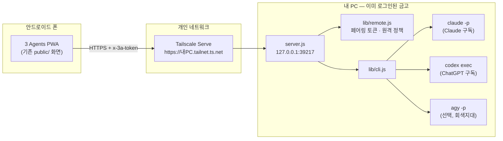

# 3 Agents — 안드로이드에서 "API 키 없이 로그인만으로" 쓰기 설계

> 대상 코드: `3-agents-main` v0.4.0 (`server.js`, `lib/cli.js`, `lib/providers.js`, `public/app.js`, `desktop/main.js`)
> 작성일: 2026-10-29 · 상태: 설계안 (구현 전)

---

## 0. 한 줄 결론

**휴대폰이 AI를 직접 부르지 않고, 이미 로그인된 내 PC의 3 Agents 서버에 "원격 화면"으로 붙는 구조(PC 브릿지)** 가 현실적으로 유일하게 약관·보안·유지보수를 모두 만족합니다.

- ChatGPT(`codex`)·Claude(`claude`): PC에서 공식 CLI로 한 번 로그인 → 폰에서는 **API 키 없이** 사용 ✅
- Gemini: 2026-06-18 개인 계정 CLI 로그인 종료로 **약관을 지키면서 "로그인만으로" 쓰는 경로가 없습니다.** → 기본은 *ChatGPT + Claude 2인 합의*, 원하면 기존의 Antigravity(agy, 회색지대) 옵션 ⚠️
- 폰 쪽 앱은 새로 만들지 않고 **기존 웹 UI를 PWA로 설치**합니다 (이미 `manifest.webmanifest`·아이콘·반응형 레이아웃이 있음).

---

## 1. 요구사항 다시 정리

| # | 요구 | 해석 |
| --- | --- | --- |
| R1 | 안드로이드에서 사용 | 폰 화면에서 질문·결과·기록 확인 |
| R2 | API 키 없이 | 종량 과금 키를 발급·입력하지 않는다. 구독 로그인만 쓴다 |
| R3 | 로그인만으로 각 AI 사용 | ChatGPT / Claude / (Gemini) 각각 |
| 암묵 | 원작의 원칙 유지 | "CLI 를 실행만 하고 토큰·쿠키·자격 증명 파일은 읽지 않는다", 로컬 우선, 다른 사이트의 호출 차단 |

---

## 2. 검토한 방식과 판단 (제3자 관점)

| 방식 | 동작 | 약관 | 안정성 | 판단 |
| --- | --- | --- | --- | --- |
| **A. PC 브릿지 (권장)** | 폰 PWA → (Tailscale/LAN) → 내 PC 서버 → 공식 CLI | 공식 CLI 를 본인 PC에서 본인이 실행 — 지금 데스크탑 앱과 동일 | 높음 (기존 코드 재사용) | **채택** |
| B. 폰에서 직접 CLI (Termux) | Termux 안에 Node + `claude` + `codex` 설치 | 공식 CLI 자체는 OK | **낮음** — Claude Code 는 2026년 기준 Android용 네이티브 바이너리를 배포하지 않아 커뮤니티 패치가 필요하고, `codex login` 은 Termux 에서 토큰 교환 실패·IPv6 시간 초과 보고가 있음. 안드로이드가 백그라운드 프로세스를 죽임 | 실험 옵션으로만 문서화 (§7) |
| C. 앱에 각 사 OAuth 로그인 직접 구현 | Codex/Claude Code 의 client_id 로 로그인해 토큰을 앱이 보관 | **Anthropic 은 2026-02 문서에서 Free/Pro/Max 구독 OAuth 토큰을 다른 제품·도구(Agent SDK 포함)에서 쓰는 것을 금지**. 남의 client_id 사용은 공식 클라이언트 위장 | 서버 측 차단 시 즉시 중단 | **기각** |
| D. WebView 에 chatgpt.com·claude.ai·gemini 를 띄우고 자동 입력·화면 긁기 | 사용자는 웹에 로그인, 앱이 DOM 조작 | 각 사 이용약관의 "자동화된 접근·데이터 추출" 금지에 해당 | UI 바뀌면 깨짐, 봇 탐지 | **기각** |
| E. 쿠키·세션 토큰을 꺼내 내부 API 호출 | 비공식 백엔드 API 직접 호출 | D 와 같음 + 원작 원칙 위반 | 매우 낮음, 보안 위험 | **기각** |
| F. 클라우드 서버에 CLI 를 올리고 여러 명이 접속 | 공유 서버 | 구독 계정 공유 금지 | — | **기각** (개인 전용 유지) |

> 솔직한 평가: "폰 혼자서, 키 없이, 세 회사 AI를 모두"라는 목표는 2026년 10월 현재 각 사 정책 때문에 **완전히는 불가능**합니다. 가능한 최대치는 "PC 한 대를 로그인 금고로 두고, 폰은 리모컨"입니다. 대신 이 방식은 코드 변경이 작고, 원작이 이미 지키는 보안 모델을 그대로 이어갑니다.

---

## 3. 전체 구조



- **왜 Tailscale Serve 를 1순위로 두는가**
  1. 서버는 계속 `127.0.0.1` 에만 열린다 → 원작의 "포트를 외부에 열지 마세요" 원칙을 깨지 않는다.
  2. 유효한 HTTPS 인증서가 자동으로 붙는다 → 안드로이드 Chrome 에서 **PWA 설치**가 된다 (설치는 HTTPS 필요).
  3. 내 tailnet 기기만 접근 가능 + WireGuard 암호화. 공유기 포트포워딩이 필요 없다.
- **LAN 직접 접속(같은 와이파이)** 은 보조 옵션: `HOST=0.0.0.0`. HTTP 평문이라 토큰이 같은 망에 노출될 수 있고, PWA 정식 설치가 안 된다(바로가기만). 집 와이파이 한정으로만 안내.

---

## 4. 서버 설계 (PC 쪽)

### 4.1 새 설정값 (`.env` / 데스크탑 설정)

| 변수 | 기본 | 의미 |
| --- | --- | --- |
| `REMOTE` | `0` | `1` 이면 원격(폰) 접속 허용 |
| `REMOTE_HOSTS` | `''` | 허용할 Host 이름 목록. 예: `mypc.tail1234.ts.net,192.168.0.10` |
| `HOST` | `127.0.0.1` | Tailscale Serve 쓰면 그대로. LAN 직접 접속일 때만 `0.0.0.0` |

`LOGIN_ONLY` 는 별도 변수로 두지 않고 **원격 요청에는 항상 적용**합니다(아래 4.4).

### 4.2 요청 분류: "로컬"과 "원격"

현재 `guard()` 는 `host` 가 루프백이면 Host 헤더도 루프백만 허용합니다. Tailscale Serve 는 **127.0.0.1 소켓으로 들어오지만 Host 가 `*.ts.net`** 이므로, 소켓 주소만으로 판단하면 안 됩니다.

```text
로컬  = 소켓 remoteAddress 가 루프백  AND  Host 헤더가 루프백
원격  = 그 외 전부
```

- 로컬(데스크탑 Electron, PC 브라우저): 지금과 동일. 토큰 불필요.
- 원격: `REMOTE=1` 이고 Host 가 `REMOTE_HOSTS` 에 있어야 하며, **페어링 토큰 필수**.
- Origin 검사(`originHost === req.headers.host`)는 그대로 유지 → 다른 사이트의 CSRF 차단은 원격에서도 동작.

### 4.3 페어링 토큰 (`lib/remote.js`, 신규)

```js
// 설계 스케치 — 실제 구현 시 테스트와 함께 작성
export class RemoteAccess {
  constructor({ dataDir, env }) { /* REMOTE, REMOTE_HOSTS 파싱 */ }
  async token()        // <dataDir>/remote.json 에서 읽고, 없으면 randomBytes(32).toString('base64url') 생성 (파일 권한 0600)
  async rotate()       // 새 토큰 발급 → 기존 폰 연결 모두 끊김 (분실 대비)
  isLocal(req)         // 4.2 규칙
  allowedHost(req)     // REMOTE_HOSTS 비교 (포트 제거, 소문자)
  async verify(req)    // 헤더 x-3a-token 과 timingSafeEqual 비교
  async pairUrl(base)  // `${base}/#pair=${token}` — 토큰을 '#' 뒤에 둬서 서버 로그·Referer 에 남지 않게 한다
}
```

- 토큰은 **쿠키가 아니라 커스텀 헤더**로 보낸다 → 브라우저가 자동으로 붙이지 않으므로 CSRF 가 구조적으로 불가능.
- 256비트 난수라 무차별 대입은 현실적이지 않지만, 원격 401 이 연속 20회면 1분간 원격 요청을 거부하는 단순 지연을 둔다.
- 정적 파일(`public/`)은 비밀이 없으므로 토큰 없이 서빙 → 페어링 전에도 화면은 뜨고 "연결 필요" 안내를 보여줄 수 있다.

### 4.4 원격 요청에 거는 제한 (= 로그인 전용 정책)

| 엔드포인트 | 로컬 | 원격 |
| --- | --- | --- |
| `POST /api/chat` | 지금과 동일 | `auth` 가 `cli` 가 아니면 **400**. 서버 `.env` 의 API 키도 **절대 사용하지 않음** (`resolveKey` 우회 금지) |
| `POST /api/models` | 동일 | `auth: 'cli'` 만 |
| `GET /api/config` | 동일 | `loginOnly: true`, `remote: true` 추가. `serverKey` 는 모두 `false` 로 보고 |
| `GET/POST /api/history` (목록·저장·조회·삭제) | 동일 | 허용 (기록은 PC 의 지정 폴더에 저장됨) |
| `POST /api/history/config` (저장 폴더 변경) | 동일 | **403** — 폰에서 PC 의 임의 경로에 파일을 쓰게 만들 수 없도록 |
| `POST /api/history/clear` | 동일 | **403** (되돌릴 수 없는 작업은 PC 에서만) |
| `POST /api/remote/rotate` (신규) | 허용 | **403** |

`server.js` 변경 지점(요약):

```js
// createAppServer 안
const remote = new RemoteAccess({ dataDir, env });

async function guard(req) {
  const local = remote.isLocal(req);
  if (!local) {
    if (!remote.enabled) throw new HttpError(403, '원격 접속이 꺼져 있습니다.');
    if (!remote.allowedHost(req)) throw new HttpError(403, '허용되지 않은 Host 입니다.');
  }
  /* 기존 Origin 검사 그대로 */
  return { local };
}
// 라우팅에서: pathname.startsWith('/api/') && !ctx.local → await remote.verify(req) (실패 시 401)
// handleChat: if (!ctx.local && body.auth !== 'cli') throw new HttpError(400, '원격 접속에서는 로그인(CLI) 방식만 쓸 수 있습니다.');
```

### 4.5 모바일 끊김 대응 (중요)

현재 `handleChat` 은 응답 소켓이 닫히면 `ac.abort()` 로 **CLI 프로세스를 죽입니다.** PC 브라우저에선 맞는 동작이지만, 폰은 화면을 끄거나 다른 앱으로 전환하면 Chrome 이 탭을 멈추면서 연결이 끊깁니다. 그대로 두면 토론 합의(호출 7회) 도중 폰을 내려놓는 순간 전부 취소됩니다.

설계: **원격 요청은 "작업(job)"으로 분리**

```text
POST /api/chat           (원격)  → 202 { jobId }       … 서버가 CLI 실행을 계속 진행
GET  /api/jobs/:id?from=N        → NDJSON: N번째 이벤트부터 재생 + 이어서 스트림
POST /api/jobs/:id/cancel        → 사용자가 '중지'를 눌렀을 때만 CLI 종료
```

- 이벤트(`meta`/`delta`/`done`/`error`)를 메모리 배열에 쌓고, 끝난 작업은 10분 뒤 삭제. 동시 작업 상한 8개.
- 클라이언트 `callAgent()` 는 끊기면 `from=받은 이벤트 수` 로 재접속(지수 백오프 1→2→4→8초).
- 합의 단계 오케스트레이션은 지금처럼 클라이언트(`app.js`)에 둡니다. 폰이 잠들어 있으면 다음 단계(합의) 시작이 늦어지지만, 이미 시작된 CLI 호출은 잃지 않습니다.
  - 2단계 개선(선택): `ask → debate → consensus` 전체를 서버의 `/api/runs` 로 옮기면 폰이 꺼져 있어도 끝까지 진행되고, 기록 저장도 서버에서 끝납니다. 변경량이 커서 1단계에서는 하지 않습니다.
- 로컬(데스크탑) 요청은 지금 동작을 그대로 유지 → 기존 테스트와 Electron 동작에 영향 없음.

### 4.6 데스크탑 앱 (`desktop/main.js` + 설정 화면)

설정(⚙) → **"휴대폰 연결"** 섹션 추가 (Electron 에서만 표시, `window.desktop` 존재 시):

1. `원격 접속 허용` 스위치 → `REMOTE` 를 사용자 데이터 폴더 설정에 저장
2. `허용할 주소` 입력 (예: `mypc.tail1234.ts.net`) + 도움말: "PowerShell 에서 `tailscale serve --bg 39217` 실행"
3. **QR 코드** 표시 (`https://<주소>/#pair=<토큰>`) — 폰 카메라로 찍으면 바로 페어링
   - CSP 가 `script-src 'self'` 이므로 외부 CDN 금지 → MIT 라이선스의 단일 파일 QR 인코더를 `public/vendor/` 에 포함하거나 main 프로세스에서 SVG 로 생성
4. `연결 초기화(토큰 재발급)` 버튼 → 폰 분실 시
5. 현재 연결된 원격 기기 수(최근 10분 내 토큰 인증 성공 IP 수)만 표시 — 개인정보 최소화

포트는 데스크탑 앱의 고정 포트 `39217` 을 그대로 사용(임시 포트로 폴백되면 "휴대폰 연결" 섹션에 경고).

---

## 5. 클라이언트 설계 (`public/app.js` — 폰과 PC 공용)

### 5.1 페어링

```js
const TOKEN_KEY = 'three-agents.remote-token';
function readPairing() {
  const m = /[#&]pair=([\w-]{40,64})/.exec(location.hash);
  if (!m) return;
  try { localStorage.setItem(TOKEN_KEY, m[1]); } catch {}
  history.replaceState(null, '', location.pathname); // 주소창·기록에서 토큰 제거
}
const authHeaders = () => {
  const t = (() => { try { return localStorage.getItem(TOKEN_KEY); } catch { return null; } })();
  return t ? { 'x-3a-token': t } : {};
};
```

- `callAgent()`, `api()`, `fetch('/api/config')` 세 곳에 `...authHeaders()` 를 붙인다.
- 401 을 받으면 화면 상단에 고정 배너: "이 기기는 PC와 연결되어 있지 않습니다. PC의 설정 → 휴대폰 연결에서 QR을 찍어 주세요."

### 5.2 로그인 전용 모드 UI (`serverCfg.loginOnly === true`)

- `authOf(id)` 가 CLI 지원 제공자에 대해 항상 `'cli'` 를 돌려주도록 분기.
- 설정 창에서 `API 키` 라디오·키 입력칸·"목록 불러오기(API)"를 숨김.
- Gemini 처리:
  - `comboSelect` 에서 `ChatGPT + Gemini(API) + Claude` 항목을 **"ChatGPT + Claude (2개)"** 로 대체.
  - 내부적으로 `settings.enabled.gemini = false` 효과 → 기존 로직(`agents.length < 2` 검사, 2개 이상이면 합의 진행)이 그대로 동작.
  - Antigravity 는 PC 에 `agy` 가 감지되고 PC 에서 이미 약관 경고를 확인한 경우에만 선택지로 노출(폰에서도 경고 대화상자 다시 표시).
- 칩 툴팁 문구: "PC의 로그인 CLI 사용" / "PC에 CLI가 없습니다 — PC에서 설치·로그인 필요".
- `기록 저장 폴더` 입력은 읽기 전용으로 표시(4.4 정책과 일치).

### 5.3 폰 화면 다듬기 (선택)

- `manifest.webmanifest`: `"share_target"` 추가 → 다른 앱에서 텍스트를 "공유 → 3 Agents" 하면 질문칸에 채워짐 (`/?q=` 를 `init()` 에서 읽음).
- 결과 탭은 이미 반응형. 모바일에서는 개별 답변 카드를 가로 스와이프(`scroll-snap`)로 보여주면 세로 스크롤이 짧아짐.
- 서비스 워커는 넣지 않는다: 오프라인 캐시가 오래된 `app.js` 를 붙잡아 서버와 버전이 어긋나는 문제가 더 크다.

---

## 6. 사용자 흐름 (설치 → 첫 질문)

1. **PC (한 번만)**: 3 Agents 설치 → 터미널에서 `claude` → `/login`, `codex login` (원작 README 그대로)
2. **PC**: Tailscale 설치·로그인 → `tailscale serve --bg 39217`
3. **PC**: 3 Agents 설정 → 휴대폰 연결 → 원격 허용 켜기, 주소 입력 → QR 표시
4. **폰**: Tailscale 앱 설치·같은 계정 로그인 → 카메라로 QR → Chrome 에서 열림 → 메뉴 "앱 설치"
5. **폰**: 홈 화면의 3 Agents 아이콘으로 질문. API 키 입력 단계 없음.

PC 가 꺼져 있으면 폰은 "PC에 연결할 수 없습니다"만 표시합니다. 이 방식의 가장 큰 단점이므로 설치 안내에 명시합니다. (Windows 전원 설정에서 "절전 안 함" 또는 Wake-on-LAN 은 사용자 선택)

---

## 7. (실험) 폰 단독 실행 — Termux

권장하지 않지만, PC 가 없는 사용자를 위해 문서로만 남깁니다.

- Termux 에 `nodejs` 설치 → 3 Agents 소스 실행(`node server.js`) → 폰 Chrome 에서 `http://127.0.0.1:3000` (localhost 는 HTTPS 없이도 PWA 설치 가능)
- 걸림돌 (2026-10 기준 공개 보고):
  - Claude Code: 공식 npm 배포에 Android 네이티브 바이너리가 없어 **커뮤니티 패치 스크립트**가 필요 → 공급망 위험, 업데이트마다 깨질 수 있음
  - Codex: Termux 에서 `codex login` 토큰 교환 실패·IPv6 시간 초과 보고, proot(Debian) 우회 필요
  - 안드로이드의 백그라운드 프로세스 제한(phantom process killer) → `termux-wake-lock` 필요
- 결론: 3 Agents 공식 지원 범위에 넣지 않고, "되면 쓰는" 고급 사용자용 메모로만 둡니다. 코드에서는 `IS_WIN` 외 경로(리눅스)가 이미 동작하므로 추가 변경은 불필요합니다.

---

## 8. 보안 점검표

| 위협 | 대책 |
| --- | --- |
| 같은 망의 다른 사람이 내 구독을 사용 | 원격은 기본 꺼짐 + 256비트 토큰 + Host 허용 목록. Tailscale 사용 시 tailnet 밖에서는 도달 불가 |
| 악성 웹사이트가 폰 브라우저로 내 PC 서버 호출 (CSRF/DNS rebinding) | 기존 Origin·Host 검사 유지 + 토큰은 커스텀 헤더라 자동 첨부 불가 |
| 토큰이 로그·히스토리에 남음 | URL `#` 뒤(서버로 전송 안 됨) → 읽은 즉시 `replaceState` 로 제거 |
| 폰 분실 | PC 에서 토큰 재발급 한 번으로 모든 원격 연결 무효화 |
| 폰에서 PC 파일 시스템 조작 | 원격은 저장 폴더 변경·전체 삭제 금지. CLI 는 기존대로 도구 끈 읽기 전용·빈 임시 폴더에서 실행 |
| 서버 `.env` API 키가 원격으로 과금 | 원격 요청은 API 키 경로 자체를 막음 (4.4) |
| 프롬프트 인젝션으로 CLI 가 도구 사용 | 기존 `--tools ''`, `--sandbox read-only`, agy 지시문 그대로 |

---

## 9. 테스트 계획 (`node:test`, 기존 스타일)

`test/remote.test.js` (신규)

1. `REMOTE` 꺼짐 + 원격 Host → 403
2. `REMOTE=1` + 허용 Host + 토큰 없음 → `/api/config` 401, `/` 정적 파일 200
3. 잘못된 토큰 → 401, 올바른 토큰 → 200 (`timingSafeEqual` 길이 불일치 경로 포함)
4. 원격 + `auth: 'api'` → `/api/chat` 400, 서버 `.env` 키가 있어도 사용 안 함
5. 원격 `POST /api/history/config`, `/api/history/clear`, `/api/remote/rotate` → 403
6. 로컬(127.0.0.1 + 루프백 Host)은 토큰 없이 기존 테스트 전부 통과 (회귀 없음)
7. 작업(job) 재접속: 모크 스트림 도중 연결 끊기 → `from=N` 으로 재접속 시 이벤트 누락·중복 없음, 클라이언트가 끊겨도 CLI 가 취소되지 않음, `cancel` 시에만 취소
8. `rotate()` 후 이전 토큰 401

수동 확인: 실제 안드로이드 Chrome + Tailscale 에서 페어링, PWA 설치, 화면 끄고 30초 뒤 복귀 시 답변 이어받기.

---

## 10. 작업 순서와 규모 추정

| 단계 | 내용 | 파일 | 규모 |
| --- | --- | --- | --- |
| 1 | 원격 판별·토큰·로그인 전용 정책 | `lib/remote.js`(신규), `server.js` | 중 |
| 2 | 클라이언트 페어링·로그인 전용 UI·2인 합의 조합 | `public/app.js`, `public/index.html`, `styles.css` | 중 |
| 3 | 작업(job) 재접속 | `server.js`, `public/app.js` | 중 |
| 4 | 데스크탑 "휴대폰 연결" 섹션 + QR | `desktop/main.js`, `preload.cjs`, `public/` | 중 |
| 5 | 테스트·README "안드로이드에서 쓰기" | `test/remote.test.js`, `README.md` | 소 |
| 6 | (선택) share_target, 카드 스와이프, `/api/runs` 서버 오케스트레이션 | — | 중~대 |

---

## 11. 남는 위험과 열린 질문

- **약관은 바뀝니다.** 이 설계는 "공식 CLI 를 본인 PC에서 본인이 실행"이라는 현재 데스크탑 앱과 같은 근거 위에 있지만, 각 사가 CLI 의 헤드리스(비대화형) 사용이나 원격 사용 자체를 제한하면 영향을 받습니다. 특히 Claude 는 구독의 제3자 도구 사용에 엄격하므로, 릴리스 전 Anthropic 의 Legal & Compliance 문서를 다시 확인해야 합니다.
- **Gemini 공백.** 로그인 전용 조건에서는 2인 합의가 기본이 됩니다. 3인 합의의 가치(교차 검증)가 줄어든다는 점을 UI에 정직하게 표시해야 합니다.
- **PC 상시 가동 필요.** 이것이 싫다면 결국 API 키 방식(종량 과금)이 유일한 대안입니다.
- **라이선스.** 원작 `LICENSE` 는 저작권자(cybereun)의 서면 허가 없는 수정·2차 저작물 작성을 금지합니다. 구현 단계는 저작권자 본인이거나 허가를 받은 경우에만 진행해야 합니다.

### 참고

- Anthropic 구독 OAuth 제3자 사용 금지 보도: [The Register (2026-02-20)](https://www.theregister.com/2026/02/20/anthropic_clarifies_ban_third_party_claude_access), [WinBuzzer](https://winbuzzer.com/2026/02/19/anthropic-bans-claude-subscription-oauth-in-third-party-apps-xcxwbn/)
- Claude Code Android 바이너리 부재: [claudeissues #72620](https://claudeissues.com/issue/72620-feature-publish-linux-arm64-android-native-binary-for-termux)
- Codex Termux 로그인 문제: [openai/codex #6632](https://github.com/openai/codex/issues/6632)
- Gemini CLI 개인 로그인 종료: [Google 공지](https://developers.google.com/gemini-code-assist/docs/deprecations/code-assist-individuals)
